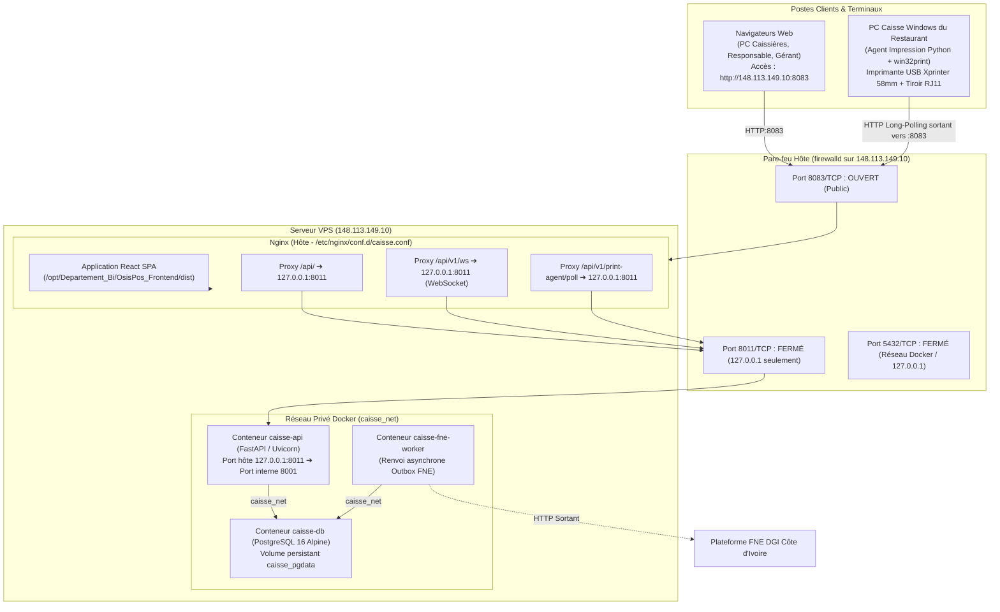

# Documentation du Déploiement Réel, Technologies et Ports — Caisse MYK (OsisPos)

> **Document dépassé (27/10/2026).** La référence est [`deploy/vps/README.md`](../deploy/vps/README.md).
> Corrections vérifiées sur le serveur : VPS **dédié** à la caisse (aucun PMS hôtelier, rien sur
> le port 8000) ; code dans `/opt/Departement_Bi/OsisPos_Backend/code` (pas `/opt/caisse/backend`) ;
> pare-feu `ufw` (pas firewalld) ; base sans port publié (pgAdmin : tunnel SSH vers l'IP du
> conteneur, pas `127.0.0.1:5432`) ; agent Windows en tâche planifiée qui interroge l'API (pas de
> NSSM ni de port 8090) ; pas de mode hors ligne ; accès cible `https://gestion.osispos.com`.

Ce document détaille l'architecture réelle déployée sur le serveur VPS de recette/production, l'inventaire exhaustif des technologies (frontend, backend, base de données, agent d'impression) ainsi que la cartographie exacte des ports et flux réseau.

---

## 1. Serveur et Environnement de Déploiement

* **Adresse IP Publique du Serveur VPS** : `148.113.149.10`
* **Système d'Exploitation Serveur** : Linux Debian (hébergement mutualisé/isolé)
* **Port Public d'Accès** : `8083` (Nginx)
* **URL d'Accès Frontend** : `http://148.113.149.10:8083/`
* **URL de l'API Backend** : `http://148.113.149.10:8083/api/v1`
* **Documentation Interactive (Swagger)** : `http://148.113.149.10:8083/docs`
* **Point de Contrôle de Santé (Healthcheck)** : `http://148.113.149.10:8083/health` ou `http://148.113.149.10:8083/api/v1/health`
* **WebSocket Temps Réel** : `ws://148.113.149.10:8083/api/v1/ws`
* **Emplacement du Build Frontend sur le VPS** : `/opt/Departement_Bi/OsisPos_Frontend/dist`
* **Emplacement du Code et Conteneurs Backend** : `/opt/caisse/backend`

---

## 2. Architecture Globale et Cartographie Réseau



---

## 3. Cartographie Complète des Ports Réseau

| Port | Protocole | Service / Composant | Scope d'écoute | Rôle & Destination |
|---|---|---|---|---|
| **8083** | TCP / HTTP | **Nginx** (Serveur Web Hôte) | **Public (`0.0.0.0:8083`)** | **Point d'entrée unique de la solution sur `148.113.149.10`.** Sert les pages React SPA et redirige les requêtes API et WebSocket. |
| **8011** | TCP / HTTP | **caisse-api** (Mappage hôte Docker) | **Local uniquement (`127.0.0.1:8011`)** | Mappe vers le port interne 8001 du conteneur API. Strictement inaccessible depuis l'extérieur (bloqué par firewalld et lié sur loopback). |
| **8001** | TCP / HTTP | **FastAPI / Uvicorn** | **Interne conteneur Docker** | Port natif sur lequel tourne le processus Python FastAPI dans `caisse-api`. |
| **5432** | TCP | **PostgreSQL 16** (`caisse-db`) | **Interne Docker (`caisse_net`)** | Base relationnelle. Port non publié sur Internet. L'accès DBA pgAdmin s'effectue par tunnel SSH (`ssh -L 5433:127.0.0.1:5432 root@148.113.149.10`). |
| **8090** | TCP / HTTP | **Agent d'impression local** | **Local PC Restaurant (`127.0.0.1:8090`)** | Port de test / mode direct sur le PC caisse Windows (optionnel si polling actif). |
| **5173** | TCP / HTTP | **Vite Dev Server** | **Machine de développement locale** | Utilisé lors du développement local du frontend (`npm run dev`). |
| **8000** | TCP / HTTP | **Django PMS** (Hôtel de la Paix) | **Interne / Réseau partagé** | Port du PMS hôtelier hébergé en parallèle sur le même serveur. |
| **22** | TCP / SSH | **Démon SSH OpenSSH** | **Restreint Administrateurs** | Accès distant sécurisé, scripts de déploiement (`deploy.sh`, `redeploy.sh`), sauvegardes. |

### Flux Spécifiques & Sécurité Réseau

1. **Routage Nginx (`/etc/nginx/conf.d/caisse.conf`)** :
   * `location /` : Sert les fichiers statiques HTML/JS/CSS de la SPA React avec fallback `try_files $uri $uri/ /index.html;`.
   * `location /assets/` : Mise en cache navigateur longue durée (1 an, `immutable`) pour les bundles hachés par Vite.
   * `location /api/` : Redirection reverse-proxy vers `http://127.0.0.1:8011` avec transmission de `X-Forwarded-For` et `X-Real-IP`.
   * `location /api/v1/ws` : Relais WebSocket avec les en-têtes `Upgrade $http_upgrade` et `Connection "upgrade"` (timeouts étendus à 86400s).
   * `location = /api/v1/print-agent/poll` : Désactivation des journaux d'accès (`access_log off;`) pour ne pas saturer les logs Nginx avec le polling toutes les 2 secondes.
   * `location ~ ^/(docs|redoc|openapi\.json|health)` : Proxy direct vers l'API pour la documentation Swagger et les sondes de santé.

2. **Isolation du Pare-feu (`firewalld`)** :
   ```bash
   firewall-cmd --permanent --add-port=8083/tcp
   firewall-cmd --reload
   ```
   * Le port `8083` est le seul port de l'application ouvert à Internet.
   * Les ports `8011` (API) et `5432` (PostgreSQL) ne sont pas ouverts, empêchant toute attaque directe.

---

## 4. Technologies et Stack Technique Complète

### 4.1. Frontend (Application Web POS / PWA)

* **Langage & Framework** : [React 19](https://react.dev/) avec [TypeScript 5.7](https://www.typescriptlang.org/) en mode strict.
* **Outil d'assemblage & Build** : [Vite 6](https://vite.dev/) (`@tailwindcss/vite`, build optimisé pour distribution statique).
* **Styling & Design System** :
  * [Tailwind CSS v4](https://tailwindcss.com/) avec variables CSS personnalisées.
  * Primitives [Radix UI](https://www.radix-ui.com/) et composants ergonomiques adaptés au tactile et au clavier (shadcn style).
  * Bibliothèque d'icônes : [Lucide React](https://lucide.dev/).
  * Polices web : *Bricolage Grotesque* (titrage expressif) et *IBM Plex Sans* (textes de caisse et chiffres tabulaires).
* **Gestion d'État & Requêtes** :
  * **État Serveur** : [TanStack Query v5](https://tanstack.com/query/latest) (cache, déduplication, rafraîchissement en arrière-plan, invalidation des états de table).
  * **État Client Global** : [Zustand](https://github.com/pmndrs/zustand) (état de la session de caisse, panier/brouillon de commande, jetons auth).
  * **Formulaires** : [React Hook Form](https://react-hook-form.com/) associé à des schémas de validation [Zod](https://zod.dev/).
* **Client HTTP / API** :
  * [openapi-fetch](https://openapi-ts.dev/openapi-fetch/) généré à partir de `openapi.json` (sécurité de typage totale bout-en-bout).
* **Visualisation & Notifications** :
  * [Apache ECharts](https://echarts.apache.org/) (graphes d'analyse de chiffre d'affaires, répartition par mode de paiement, rapport Z).
  * [Sonner](https://sonner.emilkowal.ski/) (notifications toasts animées).
* **PWA & Offline** :
  * Manifeste PWA et Service Worker pour installation bureau/mobile et résilience aux coupures réseau temporaires.

### 4.2. Backend (API Métier & Services)

* **Langage & Framework** : [Python 3.12](https://www.python.org/) avec [FastAPI](https://fastapi.tiangolo.com/).
* **Serveur ASGI** : [Uvicorn](https://www.uvicorn.org/) pour le traitement asynchrone HTTP/1.1 et WebSocket.
* **Validation & Modèles** : [Pydantic v2](https://docs.pydantic.dev/) (validation stricte des entrées/sorties).
* **Persistance Relationnelle & ORM** :
  * [SQLAlchemy 2.0](https://www.sqlalchemy.org/) (mappings déclaratifs ORM, pattern Unit of Work).
  * Driver natif : [Psycopg 3](https://www.psycopg.org/psycopg3/) (`postgresql+psycopg://...`).
  * Migrations séquentielles de schéma : [Alembic](https://alembic.sqlalchemy.org/) (versions `0001` à `0007+`).
* **Sécurité & Authentification** :
  * Algorithme [Argon2-cffi](https://pypi.org/project/argon2-cffi/) pour le hachage des codes PIN utilisateurs (caissier, responsable, admin).
  * [PyJWT](https://pyjwt.readthedocs.io/) pour l'émission des tokens JWT `access_token` (15 min) et `refresh_token` (12 h).
* **Invariants Métier Non Négociables** :
  * Monnaie : **Entiers stricts en FCFA (XOF)** sans aucun float pour éviter toute dérive d'arrondi.
  * Immuabilité : Tout encaissement est définitif (les annulations génèrent des avoirs/remboursements inverses tracés).
  * Idempotence : En-têtes `Idempotency-Key` et `X-Device-Id` obligatoires pour les opérations financières.
  * Facturation Normalisée (FNE Côte d'Ivoire) : Module d'intégration DGI avec modes `mock`, `manual` et `api`.

### 4.3. Base de Données

* **Moteur** : [PostgreSQL 16](https://www.postgresql.org/) (conteneur officiel `postgres:16-alpine`).
* **Volume Docker Persistant** : `caisse_pgdata` stocké dans `/var/lib/postgresql/data`.
* **Configuration Locale** : Fuseau horaire configuré sur `Africa/Abidjan` (UTC+0).
* **Isolation** : Schéma et base `caisse` strictement indépendants des autres applications présentes sur le serveur.

### 4.4. Agent d'Impression & Matériel Restaurant

* **Exécution** : Service natif Windows d'arrière-plan sur le PC de caisse géré par **NSSM** (*Non-Sucking Service Manager*).
* **Communication Matérielle** : Pilotage du Spooler Windows natif via `win32print` et commandes binaires directes **ESC/POS**.
* **Matériel Cible** :
  * Imprimante ticket thermique USB Xprinter 58 mm (`PRINTER_WIDTH=32` caractères par ligne) ou 80 mm (`PRINTER_WIDTH=48`).
  * Tiroir-caisse connecté via câble RJ11 à l'imprimante (impulsion électrique de déclenchement `ESC p 0 25 250`).
  * Encodage : `CP850` pour l'impression fidèle des caractères accentués français.
* **Tolérance aux Pannes** : Mode polling sortant toutes les 2 secondes vers `http://148.113.149.10:8083/api/v1/print-agent/poll`. En cas de coupure internet, les travaux restent en file d'attente (`QUEUED`) et sont imprimés dès le rétablissement de la connexion.

### 4.5. Déploiement & Automatisation (Scripts `deploy/vps/`)

* **`deploy.sh`** : Script d'installation initiale (création des dossiers `/opt/caisse`, génération sécurisée des secrets `db.env` et `api.env` via `openssl`, initialisation de la base, application des migrations Alembic, import du catalogue et des tables, création du premier administrateur, génération du jeton de terminal d'impression, configuration Nginx et pare-feu).
* **`redeploy.sh`** : Déploiement continu à chaud sans interruption de service (construction de la nouvelle image Docker pendant que l'actuelle tourne, sauvegarde préalable de la base de données, application des nouvelles migrations, bascule en ~3 secondes).
* **`backup.sh`** : Script de sauvegarde PostgreSQL quotidienne automatisée via cron (exécuté chaque nuit à 02h00 dans `/opt/caisse/backups/`).
* **`server.sh`** : Moteur serveur avec gestion des verrous exclusifs `flock` pour éviter les déploiements concurrents.

---

## 5. Configuration des Fichiers d'Environnement Clés

### Fichier `/opt/caisse/api.env` (Backend API sur le VPS)
```ini
APP_ENV=production
ENABLE_DOCS=true

DATABASE_URL=postgresql+psycopg://caisse:<MOT_DE_PASSE_SECURISE>@caisse-db:5432/caisse
JWT_SECRET=<CHAINE_ALEATOIRE_64_CHARS>
ACCESS_TOKEN_TTL_MINUTES=15
REFRESH_TOKEN_TTL_HOURS=12
PIN_MAX_ATTEMPTS=5
PIN_LOCK_SECONDS=30

CORS_ORIGINS=http://148.113.149.10:8083,http://localhost:5173
ALLOWED_HOSTS=148.113.149.10,localhost,127.0.0.1
MAX_REQUEST_BODY_BYTES=2097152

PRINT_AGENT_OFFLINE_AFTER_SECONDS=15
PRINT_JOB_STALE_SECONDS=120
PRINTER_WIDTH=32

FNE_PROVIDER=mock
TZ=Africa/Abidjan
```

### Fichier `C:\CaisseMYK\.env` (Sur le PC Windows de la Caisse)
```ini
API_URL=http://148.113.149.10:8083
TERMINAL_TOKEN=pt_xxxxxxxxxxxxxxxxxxxx
PRINTER_NAME=Xprinter_XP-58
PRINTER_CODEPAGE=CP850
POLL_INTERVAL_SECONDS=2
```
